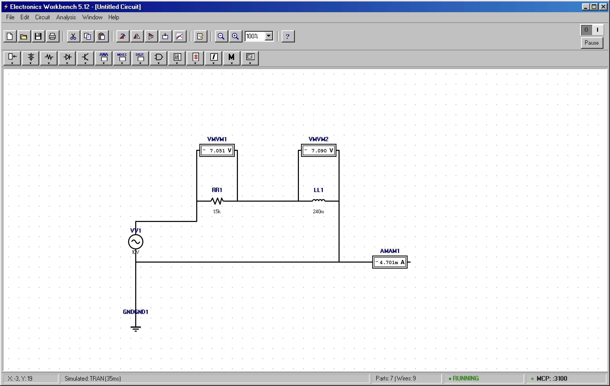
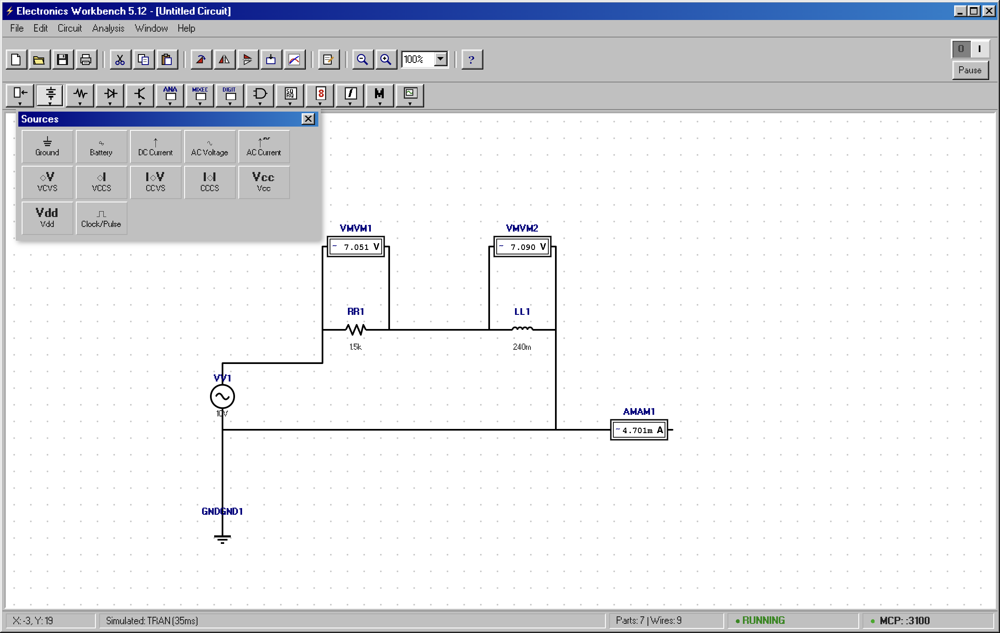
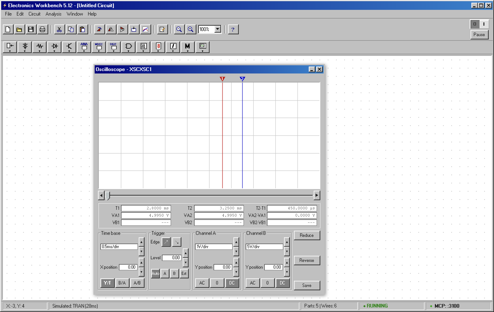

# SpiceBench

**English** | **[Русская версия](#русская-версия)**

> A modern, cross-platform (**macOS Apple Silicon / Intel** & **Windows 10/11**) electronic circuit simulator inspired by the classic **Electronics Workbench 5.12** workflow — powered by the real **`ngspice 45.2`** SPICE engine (WebAssembly via `eecircuit-engine`) with a built-in **MCP (Model Context Protocol) server** for AI agents.

---

## Core Idea

**Electronics Workbench 5.12** remains one of the fastest and most intuitive educational circuit simulators ever built, but it is a closed, Windows-only legacy binary from the 1990s.

**SpiceBench** is a clean-room modern edition of that familiar interface built on top of **`ngspice 45.2` (WASM, Modified BSD)**:
- **Cross-platform desktop app** (Electron + React + TypeScript) with consistent rendering on macOS and Windows.
- **Real SPICE simulation** (`ngspice` running in an isolated Node `worker_threads` process with a hard 5-second timeout guard — zero simulation math in the UI renderer).
- **AI-native via MCP** (`@modelcontextprotocol/sdk`, Streamable HTTP `http://127.0.0.1:3100/mcp` and `stdio`): AI agents (Cursor, Claude Code, Claude Desktop, Antigravity, etc.) can build circuits, run `ngspice`, read virtual instruments, and watch the schematic update live in the GUI.

---

## Screenshots (Live Electron App)

### AC Circuit with Live On-Schematic Voltmeters & Ammeter (`ngspice` TRAN RMS)


### Classic EWB 5.12 Toolbars & Floating Parts Bin (`Sources`)


### Dual-Channel Oscilloscope with Cursors & Readouts


---

## What Is Implemented (Current Version `0.1.0`)

- **Simulation Engine (`packages/sim`):**
  - **`ngspice 45.2` (WebAssembly / `eecircuit-engine`)** running in Node `worker_threads` with hard 5 s timeout, automatic worker recovery, and structured SPICE error reporting mapped to component IDs.
  - Supports `.op`, `.tran`, `.ac`, and `.dc` analyses. Single "Power On" automatically executes all analyses required by the instruments on the schematic.
  - **183 automated tests** (22 test suites) including analytical Golden Fixtures (divider, RC step, RLC resonance, 1N4148 diode, 2N3904 BJT, op-amp AC, 555 astable, logic truth tables) and a smoke test covering all 42 non-ground component types on `ngspice`.
- **Component Library (`packages/core` — 43 component types):**
  - **Sources (12):** Ground, DC Voltage (Battery), DC Current, AC Voltage (RMS), AC Current (RMS), Pulse/Clock, `VCC`, `VDD`, and all 4 controlled sources (`VCVS`, `VCCS`, `CCVS`, `CCCS`).
  - **Basic (6):** Resistor, Capacitor, Polarized Capacitor, Inductor, SPST Switch (interactive), Potentiometer (interactive).
  - **Diodes & Transistors (7):** Diode (`1N4148`), Zener (`BZX55C5V1`), LED (glows live), BJT NPN (`2N3904`), BJT PNP (`2N3906`), NMOS (`2N7000`), PMOS (`BS250`).
  - **Analog & Mixed ICs (4):** Ideal Op-Amp, LM741 Op-Amp, NE555 Timer (with RS latch macromodel).
  - **Logic Gates (6):** AND, OR, NOT, NAND, NOR, XOR (implemented via ngspice B-sources).
  - **Indicators (4):** On-schematic **Voltmeter** (`DC/AC RMS`), on-schematic **Ammeter** (`DC/AC RMS`), Bulb (glows live), 7-Segment Display.
  - **Instruments (4):** Multimeter (`V`, `A`, `Ω`, `dB`, DC/AC), Function Generator (sine/square/triangle, amplitude, offset, duty cycle, inverted `−` output), Dual-Channel Oscilloscope (10×6 grid, cursors 1/2, `T1/T2/Δ` readouts, `Y/T`, `B/A`, `A/B`, `Reduce`, `Reverse`, CSV `Save`), Bode Plotter (magnitude dB & phase deg `Vout/Vin`).
- **Schematic Editor & Win95 UI (`apps/desktop`):**
  - Integer logical grid, orthogonal Manhattan wire routing with junction dots, Undo/Redo, Cut/Copy/Paste, Rotate 90°, Zoom (`50%–200%`), Show Grid / Node Voltages toggles.
  - Native Save/Open (`.ewb.json`) and SPICE netlist Export/Import (`.cir`).
- **Built-in MCP Server (`packages/mcp`):**
  - Streamable HTTP on `http://127.0.0.1:3100/mcp` (loopback-only, Host/Origin validation, no wildcard CORS, isolated `McpServer` per client sharing one `CircuitSession`).
  - 10 MCP tools (`get_circuit_state`, `place_component`, `update_component`, `remove_component`, `connect_pins`, `validate_circuit`, `run_simulation`, `read_instrument`, `export_spice`, `reset_circuit`) with real-time GUI synchronization and an in-app AI Activity Log (`Window → MCP Server Settings...` / `Ctrl+M`).

---

## What Is NOT Done Yet (Known Limitations)

Full prioritized backlog is tracked in [`docs/TODO.md`](docs/TODO.md):

- **Missing Components in Parts Bins:**
  - *Basic:* Transformer, Relay, SPDT Switch, Time-Delay / Voltage-Controlled Switch, Fuse.
  - *Semiconductors:* Bridge Rectifier, Schottky Diode, Varactor, SCR, TRIAC, JFET (N/P), IGBT.
  - *Sources (bottom row):* AM, FM, PWL (piecewise linear), FSK, polynomial/nonlinear dependent sources.
  - *Empty Bins:* `Digital` (D/JK/RS flip-flops, adders, mux/demux, counters), `Digital ICs` (74xx/40xx), `Controls` (summer, integrator, transfer function), `Miscellaneous` (crystal, DC motor, optocoupler, text box).
  - *Indicators:* Logic Probe, Decoded 7-Segment (BCD), Bargraph, Buzzer.
- **Missing Digital Instruments:** Word Generator, Logic Analyzer, Logic Converter.
- **Simulation & UI Gaps:**
  - **Continuous `.tran` streaming & `Pause (F9)`:** transient runs currently simulate one fixed screen window (`10 div × timebase`), not a continuously scrolling stream.
  - **Oscilloscope `AC` coupling** does not yet subtract DC offset in the backend.
  - **Editor features:** `Flip Horizontal / Vertical`, `Create Subcircuit`, `Print...`, `Copy as Bitmap`, wire color picker.
  - **Advanced `Analysis` dialogs:** DC Sweep, Fourier, Noise, Distortion, Parameter/Temperature Sweep, Monte Carlo, Analysis Options.
  - **Visual audit:** Multimeter, Function Generator, and Bode Plotter windows have not yet been pixel-matched against original EWB 5.12 screenshots (only the main window and Oscilloscope have).
- **Packaging & Security:**
  - macOS `.app` bundle is **unsigned** (no Apple Developer ID; macOS Gatekeeper will ask for confirmation on first launch).
  - Windows 10/11 `.exe` packaging is configured in GitHub Actions (`.github/workflows/release.yml`), but has not yet been tested on a live Windows machine.
  - MCP HTTP server binds to `127.0.0.1` without an auth token. Headless `packages/mcp/dist/cli.js` and `NativeNgspiceEngine` (CLI ngspice) have not been verified in production.

---

## Architecture

```text
Renderer (React + 98.css + SVG/Canvas)   <-- thin UI client, zero simulation math
          ▲   │
          │   ▼  Typed IPC (Preload Bridge)
Electron Main / Headless Node Backend
 ├── packages/core   — Zod JSON circuit graph (integer grid), Manhattan router, Undo/Redo, validator
 ├── packages/sim    — SPICE netlist compiler + ngspice 45.2 WASM worker (5 s timeout) + instrument math
 └── packages/mcp    — MCP server (Streamable HTTP /mcp + stdio) for AI agents
```

---

## Quick Start (Development & Build)

Requirements: **Node.js 22+**, **pnpm 11+**.

```bash
# Install dependencies
pnpm install

# Run typecheck, linter, and all 183 tests
pnpm typecheck && pnpm lint && pnpm test

# Run desktop app in dev mode (Vite + Electron)
pnpm --filter @spicebench/desktop dev

# Build production bundle
pnpm --filter @spicebench/desktop build

# Pack macOS .app bundle (outputs apps/desktop/release/mac-arm64/SpiceBench.app)
cd apps/desktop && ./node_modules/.bin/electron-builder --dir -c electron-builder.json
```

### Cross-Platform Builds (GitHub Actions)
Push to GitHub and trigger **Actions → Release Build** (or push a tag `v0.1.0`) to automatically build installers for **Windows 10/11** (`.exe` NSIS + portable) and **macOS** (`.dmg` + `.zip`).

---

## Connecting AI Agents (MCP)

While SpiceBench is running, the built-in MCP server listens at:
- **Endpoint:** `http://127.0.0.1:3100/mcp` (Streamable HTTP)
- **Health check:** `curl http://127.0.0.1:3100/health`

Example client config (Cursor / Claude Code):

```json
{
  "mcpServers": {
    "spicebench": {
      "url": "http://127.0.0.1:3100/mcp"
    }
  }
}
```

---

## Legal Notice (Clean-Room Implementation)

SpiceBench is an independent, clean-room open-source project. It is **not** affiliated with Interactive Image Technologies or National Instruments (NI Multisim). No original Electronics Workbench binary code or assets are used; all circuit solving is performed by **`ngspice`** (Modified BSD license).

---
---

# Русская версия

> Современная кроссплатформенная (**macOS Apple Silicon / Intel** и **Windows 10/11**) редакция классического симулятора электронных схем в стиле **Electronics Workbench 5.12** — на базе настоящего SPICE-ядра **`ngspice 45.2`** (WebAssembly через `eecircuit-engine`) и со встроенным **MCP-сервером (Model Context Protocol)** для ИИ-агентов.

---

## Идея проекта

**Electronics Workbench 5.12** остаётся одним из самых удобных и наглядных учебных симуляторов электроники, но это закрытая программа 1990-х годов только под Windows.

**SpiceBench** — современная clean-room реализация привычного интерфейса на базе открытого расчётного ядра **`ngspice 45.2` (WebAssembly, лицензия Modified BSD)**:
- **Кроссплатформенное десктопное приложение** (Electron + React + TypeScript) с идентичным рендерингом на macOS и Windows 10/11.
- **Настоящий SPICE-расчёт:** `ngspice` работает в изолированном потоке `worker_threads` с жёстким таймаутом 5 секунд — в UI-слое (Renderer) нет никакой физики и подмены расчётов.
- **Встроенный MCP-сервер для ИИ-агентов** (`@modelcontextprotocol/sdk`, Streamable HTTP `http://127.0.0.1:3100/mcp` и `stdio`): внешний ИИ-агент (Cursor, Claude Code, Claude Desktop, Antigravity) может собирать схемы, запускать `ngspice`, снимать показания приборов, и все изменения мгновенно отображаются на экране пользователя.

*(Скриншоты реального интерфейса см. в разделе [Screenshots](#screenshots-live-electron-app) выше.)*

---

## Что уже реализовано (версия `0.1.0`)

- **Расчётное ядро (`packages/sim`):**
  - **`ngspice 45.2` (WASM / `eecircuit-engine`)** в `worker_threads` с жёстким таймаутом 5 с, автоперезапуском воркера и структурированными ошибками с привязкой к ID компонентов.
  - Поддержка анализов `.op`, `.tran`, `.ac`, `.dc`. Включение питания («Power On») само выполняет все анализы, нужные установленным приборам.
  - **183 автотеста** (22 файла), включая аналитические эталоны (делитель, переходный процесс RC, резонанс RLC, диод 1N4148, транзистор 2N3904, ОУ `.ac`, астабильный таймер 555, таблицы истинности логики) и smoke-тест всех 42 типов компонентов на `ngspice`.
- **Библиотека компонентов (`packages/core` — 43 типа):**
  - **Sources (12):** Земля, батарея (DC V), источник DC-тока, AC-напряжение (RMS), AC-ток (RMS), импульсный/тактовый источник, шины `VCC`/`VDD` и все 4 управляемых источника (`VCVS`, `VCCS`, `CCVS`, `CCCS`).
  - **Basic (6):** Резистор, конденсатор, электролитический конденсатор, катушка индуктивности, интерактивный ключ SPST, интерактивный потенциометр.
  - **Diodes & Transistors (7):** Диод (`1N4148`), стабилитрон (`BZX55C5V1`), светодиод (светится при токе), BJT NPN (`2N3904`), BJT PNP (`2N3906`), NMOS (`2N7000`), PMOS (`BS250`).
  - **Analog & Mixed ICs (4):** Идеальный ОУ, ОУ LM741, таймер NE555 (с RS-защёлкой).
  - **Logic Gates (6):** AND, OR, NOT, NAND, NOR, XOR (макромодели на B-источниках ngspice).
  - **Indicators (4):** Схемный **Вольтметр** (`DC/AC RMS`), схемный **Амперметр** (`DC/AC RMS`) прямо на холсте, лампочка, 7-сегментный индикатор.
  - **Instruments (4):** Мультиметр (`V`, `A`, `Ω`, `dB`, DC/AC), функциональный генератор (синус/меандр/треугольник, амплитуда, смещение, скважность, инверсный выход `−`), двухканальный осциллограф (сетка 10×6, курсоры 1/2, отсчёты `T1/T2/Δ`, `Y/T`, `B/A`, `A/B`, `Reduce`, `Reverse`, сохранение CSV), плоттер Боде (АЧХ дБ и ФЧХ градусы `Vout/Vin`).
- **Редактор схем и интерфейс EWB 5.12 (`apps/desktop`):**
  - Целочисленная координатная сетка, ортогональная трассировка проводов (Manhattan routing) с точками соединений, Undo/Redo, Cut/Copy/Paste, поворот на 90°, масштаб `50%–200%`, скрытие сетки/напряжений узлов.
  - 14 полок компонентов с плавающими окнами, классические SVG-иконки тулбара и меню `File / Edit / Circuit / Analysis / Window / Help`.
  - Сохранение/открытие `.ewb.json` и экспорт/импорт SPICE-нетлистов (`.cir`).
- **Встроенный MCP-сервер (`packages/mcp`):**
  - Streamable HTTP на `http://127.0.0.1:3100/mcp` (только loopback, проверка Host/Origin, без `CORS *`, отдельный `McpServer` на каждого клиента поверх общей `CircuitSession`).
  - 10 MCP-инструментов + живой лог действий ИИ в GUI (`Window → MCP Server Settings...` / `Ctrl+M`).

---

## Что НЕ сделано в текущей версии (ограничения и планы)

Полный список задач ведётся в [`docs/TODO.md`](docs/TODO.md):

- **Недостающие элементы в полках:**
  - *Basic:* трансформатор (`TRANSFORMER`), реле (`RELAY`), переключатель `SPDT`, реле времени / управляемый ключ, предохранитель (`FUSE`).
  - *Полупроводники:* диодный мост (`BRIDGE_RECTIFIER`), диод Шоттки, варикап, тиристор/симистор, `JFET` (N/P), `IGBT`.
  - *Sources (нижний ряд):* `AM`, `FM`, `PWL` (кусочно-линейный), `FSK`, полиномиальные/нелинейные зависимые источники.
  - *Пустые полки:* `Digital` (триггеры D/JK/RS, сумматоры, мультиплексоры, счётчики), `Digital ICs` (серии 74xx/40xx), `Controls` (сумматор, интегратор, передаточные функции), `Miscellaneous` (кварц, DC-двигатель, оптопара, текстовые подписи).
  - *Indicators:* логический пробник (`PROBE`), 7-сегментник с BCD-дешифратором, линейка светодиодов, зуммер.
- **Недостающие цифровые приборы:** генератор слова (`Word Generator`), логический анализатор (`Logic Analyzer`), логический преобразователь (`Logic Converter`).
- **Пробелы симуляции и редактора:**
  - **Непрерывный прогон `.tran` и кнопка `Pause (F9)`:** сейчас расчёт идёт на одно окно осциллографа (`10 div × timebase`), без потоковой прокрутки.
  - **Режим `AC` на входах осциллографа** пока не вычитает постоянную составляющую в бэкенде.
  - **Редактор:** отражение (`Flip H/V`), иерархические подсхемы (`Create Subcircuit`), печать (`Print`), копирование как картинки (`Copy as Bitmap`), выбор цвета провода.
  - **Расширенные диалоги `Analysis`:** DC Sweep, Фурье, шум, перебор параметров/температуры, Монте-Карло, `Analysis Options`.
  - **Визуальная сверка:** окна мультиметра, генератора и плоттера Боде ещё не выверены попиксельно по скриншотам оригинального EWB 5.12 (выверены главное окно и осциллограф).
- **Сборка и безопасность:**
  - Собранный macOS `.app` **не подписан** сертификатом Apple Developer ID (при первом запуске macOS попросит подтверждение через ПКМ → «Открыть»).
  - Сборка установщика Windows 10/11 (`.exe`) настроена в `.github/workflows/release.yml`, но вживую на Windows ещё не запускалась.
  - MCP HTTP-сервер слушает только `127.0.0.1`, токена авторизации нет. Запуск автономного CLI (`packages/mcp/dist/cli.js`) и `NativeNgspiceEngine` (внешний `ngspice`) отдельно не проверялись.

---

## Быстрый старт и сборка

Требования: **Node.js 22+**, **pnpm 11+**.

```bash
# Установка зависимостей
pnpm install

# Проверки типов, линтер и все 183 теста
pnpm typecheck && pnpm lint && pnpm test

# Запуск десктопного приложения в режиме разработки
pnpm --filter @spicebench/desktop dev

# Сборка продакшен-бандла
pnpm --filter @spicebench/desktop build

# Упаковка macOS .app (результат: apps/desktop/release/mac-arm64/SpiceBench.app)
cd apps/desktop && ./node_modules/.bin/electron-builder --dir -c electron-builder.json
```

### Автосборка для Windows 11 и macOS на GitHub
В репозитории настроен workflow [`.github/workflows/release.yml`](.github/workflows/release.yml): после пуша на GitHub достаточно запустить **Actions → Release Build → Run workflow** (или отправить тег `v0.1.0`), чтобы получить готовые установщики `.exe` для Windows 10/11 и `.dmg`/`.zip` для macOS.

### Подключение ИИ-агента (MCP)
При запущенном SpiceBench сервер доступен по адресу `http://127.0.0.1:3100/mcp` (проверка: `curl http://127.0.0.1:3100/health`). Конфиг для Cursor / Claude Code:

```json
{
  "mcpServers": {
    "spicebench": {
      "url": "http://127.0.0.1:3100/mcp"
    }
  }
}
```

---

## Документация проекта
- [`docs/TODO.md`](docs/TODO.md) — список пропущенных элементов, приборов и функций EWB 5.12.
- [`docs/ROADMAP.md`](docs/ROADMAP.md) — план разработки по фазам.
- [`docs/ARCHITECTURE.md`](docs/ARCHITECTURE.md) — архитектура пакетов, IPC и MCP.
- [`docs/DECISIONS.md`](docs/DECISIONS.md) — журнал архитектурных решений (ADR-001…012).
- [`docs/HANDOFF.md`](docs/HANDOFF.md) — оперативный статус проекта.
